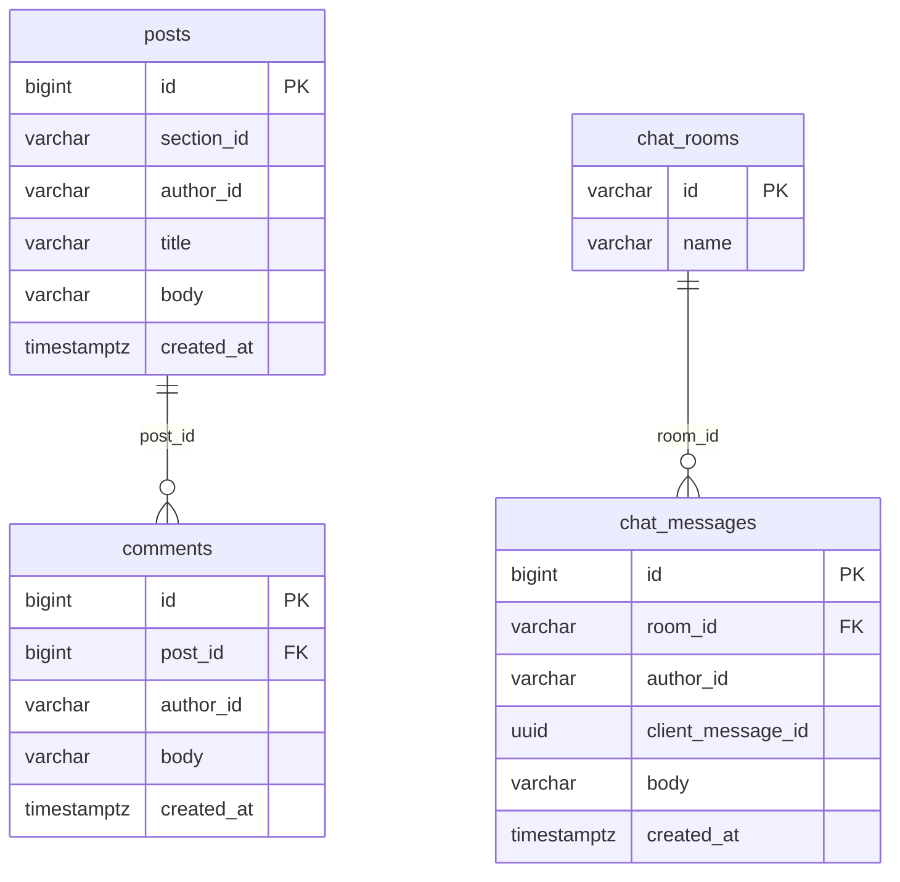

# XJTU-ApiHub 数据库设计

更新于 2026-11-24。建表语句以 [db-doc/schema.sql](db-doc/schema.sql) 为准，本文说明表之间的关系和字段用途。

## 设计约定

| 项目 | 约定 |
| --- | --- |
| 主键 | `BIGINT GENERATED ALWAYS AS IDENTITY`；`chat_rooms` 使用可读字符串 id |
| 时间 | `TIMESTAMP WITH TIME ZONE`，默认 `CURRENT_TIMESTAMP` |
| 用户标识 | `author_id VARCHAR(32)`，对应社区账号 id |
| 文本长度 | 标题 120，正文 10000，评论和消息 2000 |
| 外键 | 评论引用帖子，消息引用聊天室；暂不级联删除 |
| 幂等 | 聊天消息以 `(room_id, author_id, client_message_id)` 唯一 |

## ER 图

## 表清单

| 表 | 用途 | 主要索引与约束 |
| --- | --- | --- |
| `posts` | 论坛帖子正文 | 主键 `id`；索引 `(section_id, id)` |
| `comments` | 帖子评论 | 主键 `id`；外键 `post_id`；索引 `(post_id, id)` |
| `chat_rooms` | 聊天室 | 主键 `id` |
| `chat_messages` | 聊天室消息 | 主键 `id`；外键 `room_id`；唯一 `(room_id, author_id, client_message_id)`；索引 `(room_id, id)` |

## 表设计

### posts

论坛帖子。`section_id` 取值为接口层定义的板块 id：`clubs`、`courses`、`life`、`career`、`links`。

| 字段 | 类型 | 约束 | 说明 |
| --- | --- | --- | --- |
| `id` | `BIGINT` | 主键，自增 | 帖子 id |
| `section_id` | `VARCHAR(24)` | 非空 | 所属板块 |
| `author_id` | `VARCHAR(32)` | 非空 | 发帖人账号 id |
| `title` | `VARCHAR(120)` | 非空 | 标题 |
| `body` | `VARCHAR(10000)` | 非空 | 正文 |
| `created_at` | `TIMESTAMPTZ` | 非空，默认当前时间 | 创建时间 |

索引 `posts_section_id (section_id, id)` 支持按板块分页和游标查询。

### comments

帖子评论。

| 字段 | 类型 | 约束 | 说明 |
| --- | --- | --- | --- |
| `id` | `BIGINT` | 主键，自增 | 评论 id |
| `post_id` | `BIGINT` | 非空，外键 `posts(id)` | 所属帖子 |
| `author_id` | `VARCHAR(32)` | 非空 | 评论人账号 id |
| `body` | `VARCHAR(2000)` | 非空 | 评论内容 |
| `created_at` | `TIMESTAMPTZ` | 非空，默认当前时间 | 创建时间 |

索引 `comments_post_id (post_id, id)` 支持按帖子分页查询。

### chat_rooms

聊天室。初始化时写入 `general / 校园闲聊`，重复执行不会重复插入。

| 字段 | 类型 | 约束 | 说明 |
| --- | --- | --- | --- |
| `id` | `VARCHAR(24)` | 主键 | 房间标识 |
| `name` | `VARCHAR(64)` | 非空 | 房间显示名 |

### chat_messages

聊天室消息。客户端提交 `client_message_id` 实现重试幂等：同一房间、同一作者、同一消息 id 重复提交时返回已保存的消息。

| 字段 | 类型 | 约束 | 说明 |
| --- | --- | --- | --- |
| `id` | `BIGINT` | 主键，自增 | 消息 id，同时作为轮询游标 |
| `room_id` | `VARCHAR(24)` | 非空，外键 `chat_rooms(id)` | 所属房间 |
| `author_id` | `VARCHAR(32)` | 非空 | 发送人账号 id |
| `client_message_id` | `UUID` | 非空 | 客户端生成的消息 id |
| `body` | `VARCHAR(2000)` | 非空 | 消息内容 |
| `created_at` | `TIMESTAMPTZ` | 非空，默认当前时间 | 创建时间 |

唯一约束 `UNIQUE (room_id, author_id, client_message_id)` 保证幂等；索引 `chat_messages_room_id (room_id, id)` 支持按房间增量拉取。

## 待补充

- 登录功能需要的账号表和社区凭证表尚未设计。账号需按学号唯一，凭证只保存哈希，不保存明文。
- 删除策略尚未定义；目前外键不做级联删除。
- 数据库产品尚未最终确定，现有 DDL 基于 H2 语法。
