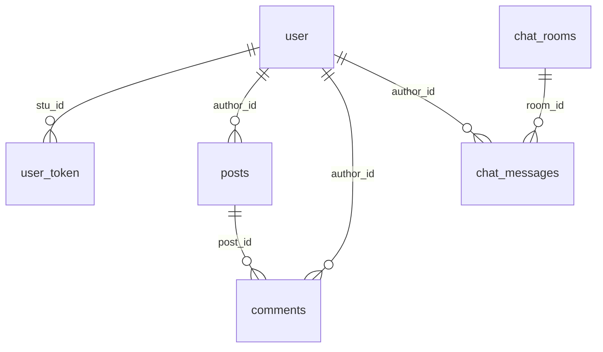

# XJTU-ApiHub 数据库设计

更新于 2026-11-24。当前生产库：阿里云本机 **MySQL 8.0.36**，库 `smart_care`（临时，与 SmartCare 共用）；后续迁移到独立库 `xjtu_apihub`。建表语句见 [db-doc/schema.sql](db-doc/schema.sql)。

## 设计约定

| 项目 | 约定 |
| --- | --- |
| 账号主键 | 学号 `stu_id`，不加代理 id；帖子、评论、聊天的 `author_id` 直接存学号 |
| 时间 | `DATETIME(6)`，应用连接统一按 UTC 处理 |
| 逻辑删除 | `is_deleted`，0 正常，1 删除 |
| 凭证 | 只存明文 token 的 SHA-256，明文只在登录响应返回一次 |
| 字符集 | 库 `utf8mb4_general_ci`；学号和 token 字段用 `ascii_general_ci` |
| 当前库 | `smart_care` 同时被 SmartCare 使用，ApiHub 只新增自己的表 |

## ER 图

## 现有表

`user` 和 `user_token` 已在 `smart_care` 创建；其余为下一阶段计划表。

### user

社区账号。`nick_name` 首次注册时确定；不传昵称时使用校方真实姓名。

| 字段 | 类型 | 约束 | 说明 |
| --- | --- | --- | --- |
| `stu_id` | `VARCHAR(16)` ascii | 主键 | 学号，唯一账号 id |
| `nick_name` | `VARCHAR(32)` | 非空 | 社区昵称 |
| `real_name` | `VARCHAR(64)` | 可空 | 校方真实姓名 |
| `grade_name` | `VARCHAR(64)` | 可空 | 年级/行政班级名称 |
| `province_code` | `CHAR(2)` ascii | 可空 | 生源省份代码，来自学号 |
| `gender` | `TINYINT` | 可空 | 1 男，2 女；来源校方 `sex` |
| `is_deleted` | `TINYINT(1)` | 非空默认 0 | 逻辑删除 |
| `degree_type` | `TINYINT` | 可空 | 2 本科，3 研究生 |
| `enrollment_year` | `SMALLINT` | 可空 | 入学年份 |
| `privacy_agreed_at` | `DATETIME(6)` | 可空 | 同意隐私协议时间 |
| `last_login_at` | `DATETIME(6)` | 可空 | 最后登录时间 |
| `created_at` | `DATETIME(6)` | 非空 | 创建时间 |
| `updated_at` | `DATETIME(6)` | 非空 | 更新时间，自动更新 |

### user_token

社区登录凭证。一个账号可以有多个 token，对应多台设备。

| 字段 | 类型 | 约束 | 说明 |
| --- | --- | --- | --- |
| `token_hash` | `CHAR(64)` ascii | 主键 | 明文 token 的 SHA-256 |
| `stu_id` | `VARCHAR(16)` ascii | 非空，外键 `user.stu_id` | 所属账号 |
| `created_at` | `DATETIME(6)` | 非空 | 签发时间 |
| `expires_at` | `DATETIME(6)` | 非空 | 过期时间，默认 90 天 |
| `revoked_at` | `DATETIME(6)` | 可空 | 吊销时间 |
| `last_used_at` | `DATETIME(6)` | 可空 | 最后使用时间 |

## 计划表

以下表尚未创建，字段先按社区功能设计。

### posts

论坛帖子。`section_id` 取值为 `clubs`、`courses`、`life`、`career`、`links`。

| 字段 | 类型 | 说明 |
| --- | --- | --- |
| `id` | `BIGINT` 自增主键 | 帖子 id |
| `section_id` | `VARCHAR(24)` | 板块 |
| `author_id` | `VARCHAR(16)` ascii | 发帖人学号 |
| `title` | `VARCHAR(120)` | 标题 |
| `body` | `TEXT` | 正文 |
| `is_deleted` | `TINYINT(1)` | 逻辑删除 |
| `created_at` / `updated_at` | `DATETIME(6)` | 时间 |

索引：`(section_id, id)`、`(author_id)`。

### comments

帖子评论。

| 字段 | 类型 | 说明 |
| --- | --- | --- |
| `id` | `BIGINT` 自增主键 | 评论 id |
| `post_id` | `BIGINT` | 所属帖子 |
| `author_id` | `VARCHAR(16)` ascii | 评论人学号 |
| `body` | `VARCHAR(2000)` | 评论内容 |
| `is_deleted` | `TINYINT(1)` | 逻辑删除 |
| `created_at` / `updated_at` | `DATETIME(6)` | 时间 |

索引：`(post_id, id)`、`(author_id)`。

### chat_rooms

聊天室。初始化写入 `general / 校园闲聊`。

| 字段 | 类型 | 说明 |
| --- | --- | --- |
| `id` | `VARCHAR(24)` 主键 | 房间标识 |
| `name` | `VARCHAR(64)` | 房间显示名 |
| `created_at` | `DATETIME(6)` | 创建时间 |

### chat_messages

聊天消息。`client_message_id` 用于客户端重试幂等。

| 字段 | 类型 | 说明 |
| --- | --- | --- |
| `id` | `BIGINT` 自增主键 | 消息 id，兼轮询游标 |
| `room_id` | `VARCHAR(24)` | 所属房间 |
| `author_id` | `VARCHAR(16)` ascii | 发送人学号 |
| `client_message_id` | `CHAR(36)` ascii | 客户端生成的消息 id |
| `body` | `VARCHAR(2000)` | 消息内容 |
| `is_deleted` | `TINYINT(1)` | 逻辑删除 |
| `created_at` | `DATETIME(6)` | 创建时间 |

唯一约束：`(room_id, author_id, client_message_id)`；索引 `(room_id, id)`。

## 迁移说明

- 当前 `user`、`user_token` 在 `smart_care` 库，和 SmartCare 的 `caregiver_info`、`patient_info` 等表共存。
- 后续创建独立库 `xjtu_apihub` 时，只迁移 ApiHub 自己的表：`user`、`user_token`，以及后续的帖子、评论、聊天表。
- 不迁移 SmartCare 的业务表。
